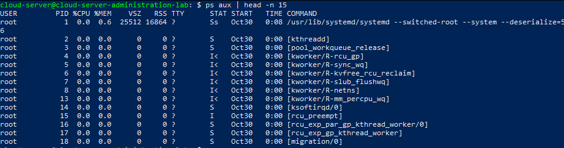
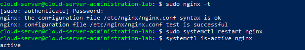
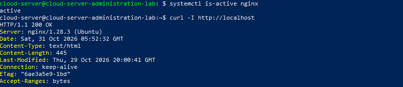

# Administración de procesos y servicios en Ubuntu Server

## 1. Descripción del módulo

Este módulo documenta la identificación, supervisión y administración de procesos y servicios en Ubuntu Server.

El objetivo es comprender cómo funciona la ejecución de procesos, identificar su relación jerárquica y verificar que los servicios esenciales del servidor estén funcionando correctamente.

**Sistema operativo:** Ubuntu Server 26.04.1 LTS  
**Servidor:** `cloud-server-administration-lab`  
**Usuario administrador:** `cloud-server`  
**Entorno:** VirtualBox

## 2. Objetivos

- Identificar los procesos activos del sistema.
- Consultar información sobre los procesos.
- Visualizar la jerarquía entre procesos.
- Consultar el estado de los servicios del sistema.
- Comprobar que SSH, Nginx y Cron estén habilitados y activos.
- Validar la configuración y disponibilidad del servidor web Nginx.

## 3. Configuración inicial

Antes de comenzar, actualizar la información de paquetes y verificar la versión del sistema.

```bash
sudo apt update
lsb_release -a
hostnamectl
```

Comprobar que el sistema reconoce correctamente el nombre del servidor:

```bash
hostname
```

## 4. Identificación de procesos

### 4.1. Mostrar los procesos activos

Ejecutar:

```bash
ps aux
```

Para visualizar solamente las primeras líneas:

```bash
ps aux | head -n 15
```

Este comando permite observar información como:

- Usuario propietario del proceso.
- PID o identificador del proceso.
- Porcentaje de CPU utilizado.
- Porcentaje de memoria utilizado.
- Estado del proceso.
- Comando que inició el proceso.

### 4.2. Consultar los procesos que consumen más memoria

```bash
ps aux --sort=-%mem | head -n 10
```

Este comando ordena los procesos según su consumo de memoria, mostrando primero los que más recursos utilizan.

### 4.3. Consultar los procesos que consumen más CPU

```bash
ps aux --sort=-%cpu | head -n 10
```

Permite identificar los procesos con mayor utilización de CPU.

## 5. Jerarquía de procesos

Para visualizar la relación entre los procesos del sistema:

```bash
pstree -p
```

Para mostrar una vista resumida:

```bash
pstree -p | head -n 20
```

La jerarquía permite observar cómo los procesos son iniciados por otros procesos.

En Ubuntu, `systemd` aparece como el proceso principal del sistema, con PID 1, y administra diferentes servicios y procesos secundarios.

## 6. Administración de servicios

Los servicios son procesos administrados por el sistema que pueden ejecutarse en segundo plano.

En este laboratorio se supervisan tres servicios importantes:

| Servicio | Función |
|---|---|
| SSH | Permite la administración remota del servidor. |
| Nginx | Proporciona el servicio web HTTP. |
| Cron | Ejecuta tareas programadas. |

### 6.1. Consultar el estado de los servicios

```bash
systemctl status ssh
systemctl status nginx
systemctl status cron
```

Para consultar únicamente si están activos:

```bash
systemctl is-active ssh nginx cron
```

### 6.2. Verificar si los servicios se inician automáticamente

```bash
systemctl is-enabled ssh nginx cron
```

Un servicio con estado `enabled` está configurado para iniciarse automáticamente durante el arranque del sistema.

### 6.3. Consultar información individual

Ejemplo para SSH:

```bash
systemctl status ssh --no-pager
```

Ejemplo para Nginx:

```bash
systemctl status nginx --no-pager
```

Ejemplo para Cron:

```bash
systemctl status cron --no-pager
```

## 7. Prueba de configuración y funcionamiento de Nginx

Como parte de la validación del servidor web, se comprobará la configuración de Nginx y su disponibilidad.

### 7.1. Validar la configuración

```bash
sudo nginx -t
```

El resultado esperado indica que la sintaxis de la configuración es correcta.

### 7.2. Reiniciar el servicio

```bash
sudo systemctl restart nginx
```

### 7.3. Comprobar que continúa activo

```bash
systemctl is-active nginx
```

El resultado esperado es:

```text
active
```

### 7.4. Comprobar la respuesta HTTP

```bash
curl -I http://localhost
```

Una respuesta HTTP `200 OK` indica que Nginx está respondiendo correctamente a la solicitud.

## 8. Resultados obtenidos

Las pruebas realizadas permitieron verificar el funcionamiento de los procesos y servicios principales del servidor.

| Comprobación | Resultado |
|---|---|
| Identificación de procesos | Correcta |
| Visualización de jerarquía | Correcta |
| Servicio SSH | active |
| Servicio Nginx | active |
| Servicio Cron | active |
| Inicio automático de SSH | enabled |
| Inicio automático de Nginx | enabled |
| Inicio automático de Cron | enabled |
| Validación de configuración Nginx | Exitosa |
| Reinicio de Nginx | Exitoso |
| Respuesta HTTP del servidor | 200 OK |

### Análisis

Se identificó a `systemd` como proceso principal del sistema, encargado de administrar los servicios y procesos secundarios.

Los servicios SSH, Nginx y Cron se encontraron activos y habilitados para iniciar automáticamente.

La configuración de Nginx superó la prueba de sintaxis, y después de reiniciar el servicio se verificó que continuaba activo.

Finalmente, mediante una solicitud HTTP local se obtuvo una respuesta `200 OK`, confirmando que el servidor web está funcionando correctamente.

**Conclusión de las pruebas:** todas las comprobaciones realizadas fueron satisfactorias.

## 9. Evidencias del laboratorio

Las siguientes capturas documentan las pruebas realizadas:

### 9.1. Procesos activos



### 9.2. Jerarquía de procesos


### 9.3. Estado de los servicios


### 9.4. Validación de Nginx



### 9.5. Prueba de respuesta HTTP



## 10. Conclusión

La práctica permitió identificar los procesos que se ejecutan en Ubuntu Server, comprender su organización jerárquica y supervisar los servicios esenciales del sistema.

Se verificó que SSH, Nginx y Cron se encontraban activos y habilitados para iniciar automáticamente.

Estas comprobaciones contribuyen a desarrollar habilidades de administración de servidores Linux, supervisión de servicios y diagnóstico básico, conocimientos fundamentales para entornos de infraestructura cloud y DevOps.